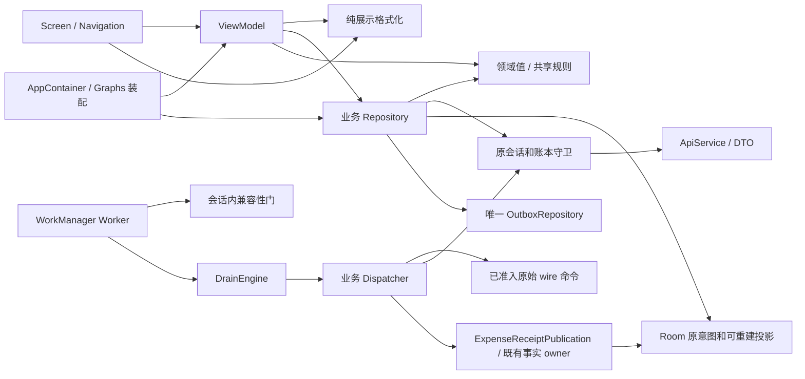

# Android 领域值、原意图与依赖边界

核对日期：2026-10-27。本轮基线为 `c7738fab5158dd3a7f23efb877c73da644145d78`，
已包含 [#681](https://github.com/xxu29958-jpg/xpj/pull/681) 与
[#682](https://github.com/xxu29958-jpg/xpj/pull/682)。本页描述所在候选的代码责任，
不表示发行、用户手机验收或整包资格已完成。

Gmail 原邮件 `1a0f78f4d88cbcbb` 中最终 Rev3.2 三份 PDF 已核对原字节。
产品合同 §6、§9、§13 要求保护事实、金额、权限和离线原意图，并保持
Screen → ViewModel → Repository → ApiService / Dao / SecureStorage；DTO、Room Entity 和会话凭据不进入 UI。
旧 `product-topology-8eb349663-20261021` 只作导航，不能覆盖当前源码或重开已关闭的 R1/公网专项。

## 完整生产责任面

路径相对 `android/app/src/main/java/com/ticketbox/`。检查覆盖整个主源集；
其他发行源集只有 manifest/resource 配置，没有另一套 Kotlin 业务实现。
目录和 import 索引覆盖全部主源集，结论还结合下列真实入口和消费者；文件数量不是拆分理由。

| 责任 | 当前 owner 与实际消费者 | 保留或迁移的依据 |
|---|---|---|
| 启动、外部分享、导航 | `TicketboxApplication`、`MainActivity`、`ui/navigation` | manifest 只进入这些应用入口；分享图片和邀请进入既有用户意图。启动协调和 WorkManager 装配保留，不成为财务 writer |
| 组合依赖 | `AppContainer`、`RepositoryGraph`、`OutboxAdapterGraph` | 构造对象、注入同一 Moshi/codec、连接生命周期通知；业务 Repository 不依赖整个组合图。兼容性规则、事实投影发布和恢复读保护已经移出根图 |
| 页面、交互状态 | `ui/screens`、`viewmodel` | 账单、往来、资金、预算/安排、规则、查询、成员、设置等真实页面全部消费领域结果和 Repository 的原意图描述；没有 DTO/Room Entity 的直接或推断类型引用 |
| 展示机制与编辑状态 | `presentation`、`viewmodel/ExpenseTimeForm`、`viewmodel/CategoryRuleDraftForm` | 金额/日期字符串格式化无 Compose、IO 或协议依赖；编辑状态归 ViewModel。页面不再作为 ViewModel 的依赖提供者 |
| 领域值与共享规则 | `domain/model` | 金额、时间、均分、往来操作资格、建议前提和只读结果；没有对 data、security、ViewModel、UI 的 import。服务端仍拥有最终授权和财务事实 |
| 业务命令和读取 | `data/repository` | 各域 Actions/Repository、QueryReader 保持原绑定、权限、读屏障与本地投影；只有实际形状或语义差异才转换。按业务 owner 保留现有仓库，不增加统一协调仓库 |
| 原命令发布与恢复 | `OutboxRepository` 及 Drain/Recovery/Status 文件 | 一个队列 owner 管理原 key、OCC、principal binding、lease、冲突和隔离；分文件仍是同一状态权威。业务 Dispatcher 使用原始 wire，不从展示对象重新构造重放 |
| 后台派发与版本门 | `OutboxDrainEngine`、`OutboxDrainWorker`、`OutboxRuntimeCompatibility` | Engine 管逐行交付和原结果，Worker 管 Android 调度结果，compatibility owner 管会话内写阻断；没有第二套重试控制器 |
| 会话、账本与凭据 | `security`、`ServerBindingRepository`、`ApiServiceProvider`、`LedgerRequestGuard`、`LocalLedgerSessionCoordinator` | SecureSessionStore 保管凭据，守卫核对账本/代际，协调者保护切换与投影发布。UI 只得显示字段/绑定状态；本地生物识别是设备解锁机制，不授予服务端权限 |
| 协议与存储 | `data/remote/api`、`data/remote/dto`、`data/local` | 同义值直接使用领域定义及原 Moshi 字段名；协议封套、不同形状的 DTO 和 Room Entity 留在 data。DAO 原子写/版本栅栏、原始命令和可重建缓存的职责继续分开 |
| 本地界面偏好 | `TicketboxSettingsStore`、`AppearanceViewModel`、`AppViewModel`、`SettingsViewModel` | 已有接口提供主题、背景和非敏感偏好；ViewModel 不持有 DAO 或存储实现。无需为包名再加转发仓库；会话凭据仍不在此接口 |
| 通知与采集 | `notification`、`notification/{backup,budget,recurring}`、`upload` | Android 通知监听受 manifest 系统权限限制；采集进入原 capture/upload Repository 和 Outbox，业务通知使用领域结果。健康/预算/固定支出提醒只读各自仓库，不自行确认事实 |

`PendingMutationStatus/Type` 是既有命令状态和值枚举，不是 Room Entity；界面描述原提交继续复用它们。
邀请输入、预览确认标识和 OCC 是用户意图/协议条件，不是登录凭据。不能按名称含 token 就删除必要恢复语义。

## 基线 → 目标 → 实际退出

| 基线的真实问题 | 目标和本候选落点 | 旧路径退出及消费者 |
|---|---|---|
| #682 之前 8 个业务文件依赖完整 `OutboxAdapterGraph` | 四组 `MutationJsonAdapters` 仅供预算/安排、固定支出、债务/复核、上传；其余具体 codec 继续直接注入 | #682 已迁移根图、仓库和 Dispatcher；业务文件对两个 Graph 引用为零 |
| 建议规则和缺汇率规则位于网络 DTO | `BudgetAdviceInputs`、`CurrencyProjectionGap` 承接原规则 | #682 已退役 DTO 规则；本轮复用已有领域值，未复制另一套判断 |
| 多个 Repository 返回网络 DTO，部分待处理状态通过嵌套字段泄漏 wire，复核状态直接暴露 Room Entity | 同义对象共用一个领域值，删除旧 DTO 和纯字段复制；Expense/Debt/Repayment、账务时间、流水投影等真实差异仍在仓库边界转换 | UI/ViewModel 只消费领域值或仓库的用户意图描述；网络、页面、测试与 AndroidTest 同步迁移，没有类型别名或通用反射转换器 |
| 待处理命令的 UI 描述同时被 Dispatcher 用作原始请求 | `readOriginalDebt*` / `readOriginalRepaymentReview` 保留同一准入校验，展示才调用 `toView`；同义的收入、固定支出当期付款、月安排、汇率和分摊提交共用原值 | Dispatcher 直接使用原提交；旧 describe → wire 反取路径和同形提交副本退出，原 key/OCC/绑定保持 |
| 迁移时缓存提交资格会在对象复制后留下过时判断 | 预算、目标创建、月安排、汇率、收入和当期付款从当前意图及原队列行计算资格，复用原准入规则 | 六处派生布尔字段退役；清空意图或修改原绑定后不沿用此前的可重试资格。协议字段不同的预算仍在原边界转换 |
| 改领域类型会改变已持久化草稿的嵌套 JSON 或对象比较 | Funds/SavedQuery/Reference 直接保存唯一草稿，复用同义领域值的原 JSON 字段名；Merchant 和 MemberSettlement 的实际格式差异局限于原存储边界；RepaymentReview 在仓库内转换 Entity | 原字段/默认值/顺序和嵌套时间字段保留；consume 仍核对原始 JSON，reviewAgain 仍核对完整已读输入，不用不同类型对象做恒假的比较 |
| AppContainer 决定回执如何写投影、兼容性如何阻断写、如何选原绑定 API | `ExpenseReceiptPublication` 由 ExpenseRepositoryCore 持有并复用原 DAO；`OutboxRuntimeCompatibility` 持有原会话内阻断流；绑定选择归 `LedgerRequestGuard` | 根图中旧 publishExpenseSnapshot/publishExpenseFactBundle、outboxWriteCompatibility/outboxApi 实现删除；Dispatcher、Worker 迁入真实 owner。原锁、版本栅栏和发布顺序保持 |
| RepositoryGraph 根据回收站类型决定恢复读保护 | `RecycleBinReadProtection` 使用各域现有 QueryReader 的 directMutation/directWrite/invalidate | 根图只连接方法引用；旧 when 流程移走，没有另一套恢复事务或财务规则 |
| ViewModel 从页面文件导入表单、金额解析、均分和操作资格 | 编辑表单归 ViewModel，纯格式化归 presentation，邀请解析/均分/往来资格归 domain | 32 个符号及全部页面、ViewModel、测试调用点迁移；旧 Formatters/页面表单文件和重复定义删除，ViewModel → UI import 为零 |

箭头表示逻辑调用/依赖；不宣称静态 import 图证明所有运行时路径。`OutboxAdapterGraph` 和
`RepositoryGraph` 保留为 composition root 是有意决定：对象较多是业务消费者较多的结果，
移走已证实的业务决策后，没有依据把它们再拆成框架或服务定位器。

## 简洁性与格式边界

领域值声明 Moshi 字段名是现有 `RecognitionFieldChoice` 等模型采用的机制，不引入新框架。
字段名注解只描述编码，不授予网络格式业务权威；请求准入、权限、金额规则、读屏障及状态迁移仍归原 owner。
语义、类型和默认值完全相同时只维护一份值定义。不得再为目录分层复制相同对象，
也不能用 JSON 往返或通用反射 mapper 隐藏复制成本。

账务时间已有本地草稿编码，Merchant 的输入与回执嵌套编码也不同；这些有具体兼容性依据的转换继续保留。
已确认流水必须经过账本验证和原投影逻辑，不能把网络结果直接当作领域事实。

## 保持与验证

- Room schema、API 字段、mutation JSON 和服务端协议保持。共享领域定义退役对应 DTO；
  必要的私有 wire 保留不同的原 JSON 形状，
  展示映射不刷新原金额、原 key、原 OCC、principal 或会话代际。请求准入和错误分类仍由原 owner 执行。
- 五项固定原始 JSON 用例覆盖资金全部 74 字段及嵌套活动部分、成员提议时间/空白、
  商户/引用创建已接受回执、保存查询 consume 原字节。旧草稿可以被新代码读出并继续使用原命令。
- 编译、完整 JVM、detekt、Lint、schema 和 Connected 结果必须绑定本次候选；返工前的绿色不能替代当前结果。
  已在未修改基线复现的 Windows DataStore 重命名和 SQLite 重新打开失败单列，云端完整 JVM 是独立门禁。
- 错误边界逐个核对并登记当前符号；Worker 的异常输出使用已有脱敏 Logcat owner，调度结果不变。
- 源码检查覆盖全部主源集，另查 UI/ViewModel 编译后类型；检查领域反向依赖、数据 → UI/ViewModel、
  ViewModel → UI、UI/ViewModel → 网络层及 DTO/Entity 泄漏。
- 完整 JVM、Lint、构建、Room schema 漂移门和 Connected 消费者旅程以本 PR 的 exact source/tree 检查为准；
  本机编译与静态检查不替代设备执行。没有重装日常手机、日常电脑或旧验收 VM。

这轮是当前实现的责任与依赖收敛，不扩展已关闭 R1/公网的验收资格；
R2/U1/C1 HOLD、iPhone 未验、iPad 后续范围保持。复杂度只保留在确有责任的 owner 和格式边界内，
不为形式上的分层向全仓扩散。
