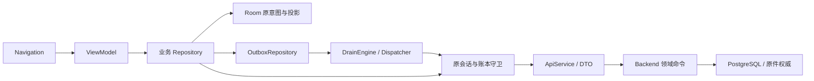
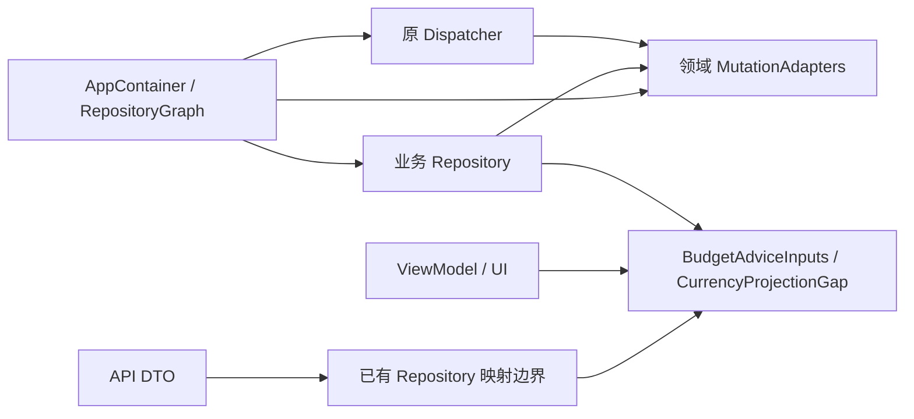

# Android 领域值与命令序列化边界

迁移基线：`663f6e165fa135907df32b115622b04e661b3e6a`，tree
`aeea02c40c2e9307f916ba6a9b915bc8e3f2a3de`。本页描述所在候选的代码责任，
不表示它已经发行、装到用户手机或完成整包资格。Windows 独立迁移见
[PR #681](https://github.com/xxu29958-jpg/xpj/pull/681)，两者没有代码依赖。

## 当前来源与产品约束

本次读取 Gmail 原邮件 `1a0f78f4d88cbcbb` 的 Rev3.2 三份原 PDF，字节与本地完整合同核对一致。
产品合同 §6、§9、§13–14 的事实、金额、权限、离线意图与恢复语义约束本次迁移。
历史拓扑 `product-topology-8eb349663-20261021` 是源码 `8eb349663` 的导航资料；
其中旧的 R1、公网及 F01–F04 状态不能覆盖当前代码和[产品地图](../current/TICKETBOX_CURRENT_PRODUCT_ATLAS.md)。

Android 保留 `:app` 一个生产 Gradle 模块；`:macrobenchmark` 是测试模块。
没有为了文件数量拆模块，也没有增加客户端财务事实或恢复协调者。

## 生产目录和纵向调用

下表路径均相对 `android/app/src/main/java/com/ticketbox/`。

| 责任 | 生产位置 | 权力与真实消费者 |
|---|---|---|
| 组合依赖 | `AppContainer.kt`、`RepositoryGraph.kt`、`OutboxAdapterGraph.kt` | 装配仓库、Dispatcher、同一 Moshi；业务仓库不反向依赖完整组合图 |
| 展示和交互 | `ui/navigation/`、`ui/screens/`、`viewmodel/` | 导航绑定、输入和交互状态，消费领域投影 |
| 命令与读取 | `data/repository/` | 原请求、身份守卫、Outbox、远端交付与本地可重建投影 |
| 协议 | `data/remote/api/`、`data/remote/dto/` | 服务端字段和 wire 值；在已有仓库边界映射需要领域规则的返回值 |
| 本地持久化与身份 | `data/local/`、`security/` | Room 原意图/缓存、安全会话；不替代服务端幂等、OCC 和财务事实 |
| 领域规则与值 | `domain/model/` | 金额、日期、建议前提、汇率缺口及已有有效性规则；不依赖 data 包 |
| 采集入口 | `notification/`、`upload/` | 进入既有采集命令和 Outbox，不建立另一条写入路径 |

## 基线问题、目标和实际退出

| 真实调用链 | 基线问题 | 本候选的边界与旧路径退出 |
|---|---|---|
| 预算/安排、固定支出、债务/还款复核、上传 → Repository → 原意图 → Dispatcher | 8 个业务源文件接收完整根组合 `OutboxAdapterGraph`，反向依赖所有命令序列化器 | `MutationJsonAdapters.kt` 的 Budget、Recurring、Debt、Upload 四组只拥有各自 23 个原有 codec；业务构造参数、根组合、Dispatcher、单测和设备测试全部迁移。根图对应平铺属性物理删除，无旧参数或兼容转发 |
| 建议输入/建议回执 → BudgetAdviceResult → ViewModel/页面 → 新鲜度和可用性判断 | 领域结果包含 `BudgetAdviceInputsDto`；DTO 自己拥有 `adviceBasis` 和 `readyForAdvice` 业务规则 | `BudgetAdviceInputs` 及其嵌套领域值承接原规则；`BudgetAdviceInputMappers.kt` 在仓库边界逐字段映射。DTO 保持原字段与 Moshi 注解，规则已移走，domain 对 data 的源码依赖归零 |
| 缺汇率拒绝 → 原历史更正/建议/报表 → 手工汇率恢复 | 页面为了调用规则构造 `MissingExchangeRateDto`；错误对象和持久待处理状态混用 wire 类型 | 原 `CurrencyProjectionGap` 统一拥有 `canEnterManualRate`。错误解析、ViewModel、导航、共享输入和恢复消费者使用它；原 DTO 仅在协议/持久 JSON 边界转换，无第二份判断规则 |

基线的 `Repository → OutboxAdapterGraph` 和 `domain → DTO` 箭头已退出。
根图仍集中配置同一 Moshi，其余 30 个 codec 原本已按具体适配器注入消费者，保留现有组合即可。
ViewModel、导航和同步状态不会创建新的转换仓库或第二条持久状态。

## 保持的执行语义

- 四组 codec 继续共享原 Moshi 配置、延迟实例化、`serializeNulls`、请求与回执字段。
  Room schema、mutation wire 值、幂等键、原绑定、原金额和原请求保持。
- 建议输入 fingerprint、缺汇率列表、参考汇率、试算与保存安排、预算定义、数据范围均显式映射。
  `adviceBasis` 仍忽略单独保存的预算和读取时间；缓存只在进程内使用，没有迁移持久缓存键。
- 历史更正的缺汇率状态继续通过原 `MissingExchangeRateDto` adapter 读写相同 JSON。
  重启恢复的内容与原意图保持，领域值不会写出新 schema。
- 其他无业务规则的 DTO 展示路径按现有边界保留，例如保存查询的结果行。
  本次消除的是已证实的逆向依赖和重复规则，不把整个协议层复制成领域层。
- 公网、R1 历史资格不扩大到本候选；R2/U1/C1 HOLD、iPhone 未验与 iPad 后续范围保持。

## 验证及范围

本机 Windows/JDK 17：生产代码、JVM 测试代码和 AndroidTest Kotlin 编译通过；
`lintGrayDebug`、`detektGrayDebug`、`detektGrayDebugUnitTest` 通过。
detekt 生产分析仍报告 31 个编译分析告警，不能把无新增 finding 当作完整类型证明；编译门单独通过。

完整 GrayDebug JVM 单测执行 2937 项，2935 通过、2 失败。定向复测和 exact 基线原 Android 源码
均复现相同两个失败：`BackgroundSettingsDataStoreTest.clearBackgroundReturnsToThemeDefault`
的临时文件重命名，以及 `DebtAcceptedReadRoomTest.missingDebtSurvivesRoomWriteFailureAndDatabaseReopenWhileOtherFactsRemainReadable`
的 SQLite 打开文件错误。没有跳过用例或改低门槛；测试数量门因单测失败尚未执行。

静态消费者复核：业务仓库对 `OutboxAdapterGraph` 引用为零，domain 对 data 引用为零，
旧 DTO 规则定义为零。错误报告审计通过。云端完整 JVM、构建与 connected 分片结果以本 PR 的
精确提交检查为准；本机编译不替代设备执行，也不代表用户手机已验证。
