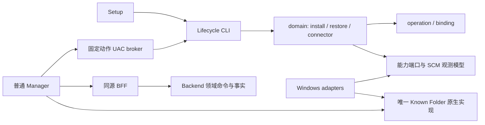

# Windows 生命周期的责任边界

核对日期：2026-10-27；迁移基线 `663f6e165fa135907df32b115622b04e661b3e6a`。
本文件描述所在候选的源码边界，不代表发行或日常安装资格。

Gmail 原邮件 `1a0f78f4d88cbcbb` 的 Rev3.2 三份 PDF 已重新核对，下载字节与完整本地正文一致。
Windows 合同 §5、§7、§17 要求保留唯一 Lifecycle、固定恢复顺序、纯策略及平台机制边界。
历史 `product-topology-8eb349663-20261021` 和架构对比图只用于定位；其中 R1、公网及 F01–F04
状态早于本基线，不能用来重开已经关闭的专项。

## 当前目录和真实调用链

| 生产位置 | 责任与消费者 |
|---|---|
| `desktop/backend_manager/` | 普通权限 Manager、同源 BFF、安装读模型、固定动作代理；不生成安装身份 |
| `distribution/windows/installer/` | Setup 物化声明载荷，调用 Lifecycle 并展示原操作结果 |
| `distribution/windows/lifecycle/ticketbox_lifecycle/domain/` | install、restore、connector 的有限编排与持久状态发布 |
| 同包 `policy/`、`adapters/`、`runtime/` | 纯策略、窄能力合同/共享机制、Windows 实现和组合 |
| `distribution/windows/build/`、`backend/packaging/`、`backend/scripts/windows_build_provenance.ps1` | 冻结程序、受信源清单与安装器来源绑定 |
| `backend/app/`、PostgreSQL、原件目录 | 财务事实和原件权威；不是宿主安装操作的第二 writer |

基线 Manager 根 42 个文件，Lifecycle runtime 根 40 个文件。数量不是拆包依据。
Manager → UAC broker → Lifecycle、Backend → PostgreSQL 的进程/权限隔离有实际消费者，予以保留。
开发模式的 SourceBackendRuntime 仍有开发入口；它没有获得已安装环境的身份发布权。

## 迁移与退役

| 基线的实际耦合 | 所在候选的责任归属 | 已退役路径 |
|---|---|---|
| restore CLI 直接发布恢复阶段和 binding，依赖源 ZIP/ACL 机制，并调用 install 私有失败函数 | `domain.restore` 保留原有限步骤；`RestorePlatform` 承担源文件、空间和 ACL；`domain.operation` 复用原失败封闭逻辑 | CLI 的恢复编排定义、install 私有失败实现及旧消费者进口 |
| Fresh/connector 策略为了使用服务数据模型导入具体 runtime | `adapters.scm` 拥有 ServiceConfiguration、FailureAction、ScmObserver | runtime 中三份类型定义及 policy → runtime 导入 |
| Manager 和 Lifecycle 各自维护 GUID/COM/SHGetKnownFolderPath | `adapters.windows_known_folders` 只有一份原生实现；调用端保留产品目录与错误文案映射 | 两端原生重复实现、Manager 的重复 COM 测试 |

CLI 继续做参数、管理员权限、组合和结果映射。R1 仍只接受干净隔离目标：
mutex → shipment/目标核验 → 源核验 → prepared → 私有提取 → ACL/SCM → 凭证轮换/身份事务 →
候选 health → fence → binding → committed → 正常 health → autostart → archive。
失败仍调用同一持久失败封闭逻辑，保留源和候选；没有新增自动续办或通用恢复系统。

新文件已加入真实安装器来源清单和独立清单契约测试；PyInstaller 的现有 import 路径纳入它们。
安装身份、DataRoot、服务名、operation/request 字段、凭证顺序、协议和错误结果均未改变。
用户仍使用原入口、原任务和原失败恢复方式，没有新增操作步骤。

## 验证及限制

本地 Windows 生命周期套件 307 通过、6 跳过；跳过的是需要管理员令牌的 ACL/受限令牌用例，
由 exact candidate Windows CI 执行。Manager 安装识别、诊断目录及原生 Known Folder 的相关消费者
已通过；来源契约 7 通过，Windows PowerShell 5.1 和 PowerShell 7 的 source preflight 均通过。
恢复的既有六项成功/失败用例现在经过公开领域入口，包含 mutex 和源上下文关闭顺序断言。

新增生产 Python 文件及修改的 Desktop 文件 Ruff 通过。将 backend Ruff 配置额外用于 Lifecycle
会报基线已有的两处 C901 和一处 B905；已对 `663f6e1` 原文件复算，未扩大阈值或添加忽略。
云端构建/运行结果以本 PR 的 exact revision 检查为准。本次没有重装日常电脑、手机或验收 VM，
也没有重跑完整 R1/公网资格。R2/U1/C1 HOLD、iPhone 未验和 iPad 后续限制保持。
